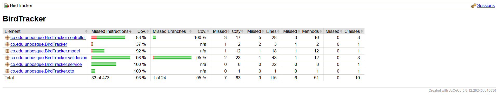

# Justificación de las pruebas — BirdTracker

**Julian Samuel Rodriguez Hernandez** · Ingeniería de Software 2

## 1. Qué cambió en el código

| Cambio | Antes | Después | Por qué hace la API más testeable |
| --- | --- | --- | --- |
| Validación extraída | Anotaciones `@NotBlank/@Size` en la entidad, disparadas por `@Valid` en el controlador. No existía la regla de 3 a 50 caracteres ni la de "fecha no posterior a hoy". | Clase propia `validacion/ValidadorDeAvistamiento`, separada del controlador y sin dependencias de Spring MVC ni de JPA. | La regla se prueba con un `new`, en milisegundos y sin levantar la API ni la base. El controlador queda solo traduciendo HTTP. |
| Reloj abstraído | La fecha de hoy tendría que salir de `LocalDate.now()`. | Interfaz `Reloj` con la implementación de producción `RelojDelSistema`, inyectada por constructor en el validador. | Inversión de dependencias: en la prueba se entrega el stub `RelojFijo`, y "mañana" es siempre 2026-10-22. Así la prueba es repetible. |
| DTO de entrada | El controlador recibía la entidad, con `fecha` de tipo `LocalDate`. | Record `dto/AvistamientoRequest`, con `fecha` como texto. | Con `LocalDate`, Jackson falla antes de llegar a la regla con un error genérico. Con texto, el validador decide el formato `AAAA-MM-DD` y dice qué campo falló. |
| Servicio | `crear` y `actualizar` guardaban lo que llegaba. | Llaman a `validador.validar(...)` antes de usar el repositorio. Repositorio y validador llegan por constructor. | El servicio se puede probar con un doble del repositorio. |
| Errores | — | `AvistamientoInvalidoException` (lleva `campo → mensaje`), manejada en `ApiExceptionHandler` con una respuesta `400` que trae `mensaje` y `detalles`. | La respuesta indica qué campo falló, como pide la regla. |
| Configuración de pruebas | — | H2 en memoria para pruebas (`src/test/resources/application.properties`) y JaCoCo en el `pom.xml`. | Las pruebas de integración no tocan `data/birdtracker.mv.db` y empiezan con la base vacía. |

## 2. Tabla de casos de la Parte A

En todos los casos el reloj está fijo en **hoy = 2026-10-21** y los demás campos son válidos, para que cada caso cambie un solo dato.

**Especie.** Particiones de equivalencia por longitud: `< 3` (inválida), `3..50` (válida) y `> 50` (inválida).

| Valor | Longitud | Tipo de caso | Resultado esperado | Por qué ese valor |
| --- | --- | --- | --- | --- |
| `"Colibrí"` | 7 | Representativo | Válido | Un valor del centro de la partición válida. |
| `"ab"` | 2 | Límite | Error en `especie` | Justo debajo del mínimo. |
| `"abc"` | 3 | Límite | Válido | El mínimo exacto: detecta si se escribió `> 3` en vez de `>= 3`. |
| `"a"` × 50 | 50 | Límite | Válido | El máximo exacto: detecta `< 50` en vez de `<= 50`. |
| `"a"` × 51 | 51 | Límite | Error en `especie` | Justo encima del máximo. |
| `"  ab  "` | 2 sin espacios | Inválido | Error en `especie` | Los espacios al inicio y al final no cuentan; sin esta prueba el valor pasaría con 6 caracteres. |
| `null` | — | Inválido | Error en `especie` | Partición "campo ausente". |

**Fecha.** Particiones: pasada (válida), hoy (válida), futura (inválida) y mal formada o inexistente (inválida).

| Valor | Tipo de caso | Resultado esperado | Por qué ese valor |
| --- | --- | --- | --- |
| `2025-03-15` | Representativo | Válido | Un valor cualquiera de la partición pasada. |
| `2026-10-21` (hoy) | Límite | Válido | El borde permitido. Solo esta fecha detecta un `>=` escrito en lugar de `>`. |
| `2026-10-22` (mañana) | Límite | Error "posterior a hoy" | El primer valor de la partición futura. |
| `21/10/2026` | Inválido | Error de formato | Otro orden de los campos y otro separador. |
| `2026-1-5` | Inválido | Error de formato | Mes y día sin dos dígitos. |
| `2026-13-01` | Inválido | Error de formato | El formato parece correcto, pero el mes no existe. |
| `2026-02-30` | Inválido | Error de formato | Fecha inexistente. Verifica el modo `STRICT`, que no la convierte en 28 de febrero. |
| `ayer` | Inválido | Error de formato | Texto libre. |
| `""` | Inválido | Error "obligatoria" | Partición "sin valor". |

**Lugar y observador.** Dos particiones: con texto (válido) y en blanco (`"   "`, `""`), que es inválido y debe reportarse con su nombre de campo.

## 3. Por qué cada nivel

- **`especieDe50Caracteres_esValida` es unitaria.** Verifica una comparación de longitud. No hay HTTP, ni JSON, ni base de datos que puedan fallar. En integración sería mucho más lenta y, si fallara, no se sabría si el problema está en la regla o en la serialización.
- **`crear_conFechaDeManana_noLlamaAlRepositorio` es unitaria del servicio.** Prueba la frontera entre servicio y repositorio: con datos inválidos no se guarda nada. Con un mock eso se verifica de forma directa (`verify(repo, never()).save(...)`).
- **`post_conEspecieDe2Caracteres_responde400IndicandoElCampoYNoGuarda` es de integración.** Comprueba lo que solo existe con todo ensamblado: que Spring inyecta el validador, que la excepción llega al `@RestControllerAdvice`, que se traduce a `400` y que el JSON trae `detalles.especie`.

**¿Qué detecta la prueba de integración del POST que la unitaria del validador no puede?** Que la API realmente pase por el validador. Si alguien quitara la llamada a `validar` en el servicio, las pruebas del validador seguirían pasando, pero la API aceptaría especies de 2 letras. También detecta errores de mapeo del JSON al DTO, el `201` con la cabecera `Location`, el `id` generado por la base y la persistencia real (el `GET` posterior devuelve lo creado).

## 4. Los dobles

| Doble | Tipo | Dónde se usa | Por qué ese tipo |
| --- | --- | --- | --- |
| `RelojFijo` | Stub | Validador, servicio e integración (como `@Primary`) | Solo se necesita que devuelva una respuesta preparada: hoy = 2026-10-21. No se verifica cómo lo llaman, así que no hace falta un mock. |
| `AvistamientoRepository` (Mockito) | Mock | `AvistamientoServiceTest` | Lo que se comprueba es la interacción: `save` se llama una vez con los datos normalizados, o nunca si los datos son inválidos o el id no existe. Un fake en memoria obligaría a implementar las decenas de métodos de `JpaRepository` para usar solo tres. |

**¿Qué habría pasado sin los dobles?** Sin el stub del reloj, una prueba con una fecha "de mañana" escrita a mano pasaría hoy y fallaría después. Usar `LocalDate.now()` dentro de la prueba la haría depender del momento de ejecución. Sin el mock del repositorio, probar el servicio exigiría la base de datos: la prueba sería lenta, dejaría datos guardados y no podría afirmar que `save` no se llamó.

## 5. Lo que no probamos

1. **`HomeController` (redirige `/` a Swagger).** No tiene lógica de negocio. Una prueba solo repetiría el `return "redirect:..."`, y si falla se nota al abrir el navegador.
2. **`RelojDelSistema.hoy()`.** Es un `return LocalDate.now();`. Probarlo sería probar la biblioteca estándar, y su resultado no es determinista. Además, es justamente la pieza que el doble reemplaza.
3. **Los máximos de 200 caracteres en `lugar` y 120 en `observador`.** No hacen parte de la regla del taller; los aplica Hibernate al guardar. Riesgo identificado: un lugar de 201 caracteres hoy produciría un `500`. Si se quisiera cubrir, habría que llevar esos máximos al validador y probarlos con 200 y 201.

## 6. Lectura de la cobertura

Criterio de cobertura: instrucciones y ramas, medidas con JaCoCo (`.\mvnw.cmd clean verify`). Se ejecutaron 38 pruebas, sin fallos.

Resultado total: **93 % de instrucciones** (33 de 473 sin cubrir) y **95 % de ramas** (1 de 24 sin cubrir). La lógica quedó en `validacion` (98 % de instrucciones y 95 % de ramas) y `service` (100 %).

Lo que quedó sin cubrir y la decisión tomada:

- **`ApiExceptionHandler.manejarValidacion` (paquete `controller`, 83 %).** Al pasar la regla al validador y quitar `@Valid` del controlador, este manejador quedó inalcanzable: es código muerto. No vale la pena escribirle una prueba, porque ninguna petición lo ejecuta. Lo correcto es eliminarlo. Aquí la cobertura no pedía más pruebas, sino que señalaba código que sobra.
- **La única rama sin cubrir, en `ValidadorDeAvistamiento.estaVacio`.** Es el caso `valor == null` para lugar, observador o fecha, es decir, un JSON que no trae esa clave. Pertenece a la misma partición ("sin valor") que ya está probada con `""` y `"   "`, así que no aporta un caso distinto. Si se quisiera el 100 % de ramas, bastaría con una prueba con `lugar = null`.
- **`RelojDelSistema.hoy()` (paquete `validacion`).** No se ejecuta porque en las pruebas siempre se reemplaza por el stub. Es intencional (ver la sección 5).
- **`Avistamiento.setId` (paquete `model`, 92 %).** Ya no se usa, porque el id lo asigna la base. No tiene comportamiento que probar.
- **`HomeController` y `BirdTrackerApplication.main` (paquete raíz, 37 %).** No se prueban, por las razones de la sección 5.

Lo que falta por cubrir es configuración o código sin uso, así que no se agregaron pruebas solo para subir el porcentaje.
